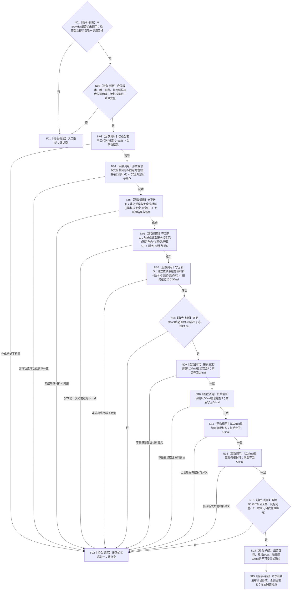

# BIZ-L3-001-03-12 初始化并读取本能根运行锚点目标函数流程图 v0.1

更新时间：2026-09-23

## 依据

```text
8121 v0.6、8120 v0.16、6130 v0.17、4115 v0.9、7130 v0.19、8100 v1.12、8200 v1.9；
BIZ-L2-001-03；
规范/详细设计/20260923_INSTINCT-ROOT-RUNTIME-ANCHOR-PROVIDER_本能根运行锚点组合提供者详细设计_v0.1.md；
计划/20260923_INSTINCT-ROOT-RUNTIME-ANCHOR-PROVIDER_本能根运行锚点组合提供者代码实施计划_v0.1.md
```

## 身份与边界

正式目标函数设计图。唯一业务目标是：调用方在阶段19成功后取得非零正式截止，按该截止完整读回真实自我并验证成功，以该新鲜投影构造一次尝试 provider；provider 只组合现行实际F provider、根材料 provider和事实代次守卫，在同一非零 `Gfinal` 正式重读安全/服务双根材料后返回不可变值式锚点。

编号 `03-12` 是稳定图身份，不表示它在 `03-11` 之后执行；目标顺序仍为 `03-10 -> 03-12 -> 03-11`。现行计划只实施组合 provider 本体及生产外专项，不授权普通应用、启动或自我线程接线；目标父链中的阶段19、自我正式重读、构造 provider、阶段21调用和失败21映射属于代码结果发布后的紧邻后继。

本函数不形成或修复安全值/服务值先天FT及完整域概念，不创建二次概念、二次实例、状态、动态、任务、方法或具体子需求，不向独立根D写入自我字段、关系或owner，也不直接访问DATA-L1。

## 函数合同

```text
根函数：本能根运行初始化提供者::初始化
归属模块 / 文件 / 目标分解深度：海中鱼巣/业务/应用服务.本能根运行初始化.h、海中鱼巣/业务/应用服务.本能根运行初始化.cpp / BIZ-L3
现有或待新增：待实施；正式规范、详细设计和可执行计划已发布，当前发布HEAD尚无这四个计划生产文件
完整签名：本能根运行初始化结果_v1 本能根运行初始化提供者::初始化(const 本能根运行初始化请求_v1& 请求) noexcept
参数：请求为只读借用，只含合同版本和唯一自我；服务引用、新鲜真实自我读取请求及其成功结果在构造 provider 时注入并锁定，不属于公开初始化请求字段
返回结果：仅已形成或已恢复成功并携带完整本能根运行锚点_v1；其它十一值合同中的非成功状态均为空锚点
被调函数流程图：现行上游 provider 内部流程不在本图复制；本图只按其公开合同调用形成或读取本能根I64实际F、建立或读取本能根材料、核验当前事实代次
```

## 流程图



## 节点合同

| 节点 | 类型 | 参数 / 输入绑定 | 结果 / 输出绑定 | 事实读写 | 后继条件 | 验证 |
| --- | --- | --- | --- | --- | --- | --- |
| N01—N03 | 指令判断 / 函数调用 | 公开请求、构造时锁定的成功自我读回及服务同上下文关系 | 唯一调用资格与起始G | 请求和值式投影只读；代次守卫零写 | 全部成立才进入安全根 | 同对象二次调用、坏版本、零/错自我、伪造读回、起始漂移 |
| N04—N07 | 函数调用 | 固定位置、角色、私有键/预算和逐步更新的G | 双根实际F、根材料和候选Gfinal | 写入只由现行实际F provider与根材料 provider各自owner完成；组合层不复制写集 | 每步成功载荷完整且后继守卫相等 | 首次、fresh恢复、部分前缀、冲突、退出、已可能发布、资源失败 |
| N08—N12 | 判断 / 函数调用 | 冻结的非零Gfinal、原完整请求和原键 | 同Gfinal四组正式重读 | 只读；每次重读前后守卫同一Gfinal；重读不得新发布 | 四组均为正式读取/恢复且身份一致 | 每个守卫漂移点、重读出现已形成、异截止或载荷缺失 |
| N13—N15 | 判断 / 构造 / 返回 | 自我、双根D/L/F/T和共同Gfinal | 已形成/已恢复及完整锚点 | 仅形成值式结果，不发布第二事实 | 全部身份与闭包互证成功 | 双根交叉、根D自我绑定、self字段映射、完整谓词 |
| F01—F02 | 指令返回 | 当前正式非成功或内部异常 | 结构化状态和空锚点 | 不回滚已发布上游事实，不换键、不补写 | 调用结束；重试须重新取得正式截止并重建provider | 十一值状态映射、异常收口、所有失败空锚点 |

## 关键边界

- 公开 `初始化` 请求只有合同版本和唯一自我，没有启动UTC、位置、FT、完整域概念、键、预算、角色或截止。
- 安全值/服务值先天FT及完整域概念已由系统初始化交付；阶段21只调用实际F provider，不直接建立二次特征概念、首值、初始状态或当前选择。
- 每个 provider 对象只允许调用一次。任何非成功、`已可能发布`、进程重启或精确重复，都必须先按阶段19合同取得新正式截止，完整重读自我并构造新 provider；不得复用旧投影或旧对象。
- 根T/D/L固定键仍由需求provider内部管理；根D父为空且没有所属存在、目标宿主、自我字段、自我关系或自我owner。逻辑归属只由阶段21入口和最终锚点表达。
- 本计划成功只证明生产外隔离范围内的组合provider及其锚点，不证明普通应用接线、阶段21启动短路、自我线程创建/停门、治理开门、跨进程故障恢复验收或自我治理闭环。

## 当前发布源码对照（物理位置复核基线 `8bc4c5527fff6ee9f8458127d96f21e5a27f202e`）

- 当前发布HEAD尚无四个计划生产文件、阶段21生产调用或锚点缓存；`启动.应用程序.cpp`仍在方法登记根成功后固定映射阶段21失败。
- 工作区中的四个同名生产文件和两个专项工程是未提交WIP，不属于发布HEAD，也不能替代施工记录、验证记录或完成证明。
- 现行可执行计划只授权组合provider本体和生产外隔离专项；普通应用、启动、根工程和自我线程消费均属代码结果发布后的紧邻后继。
